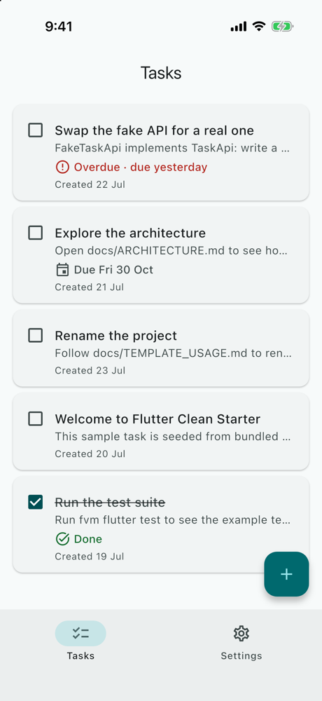
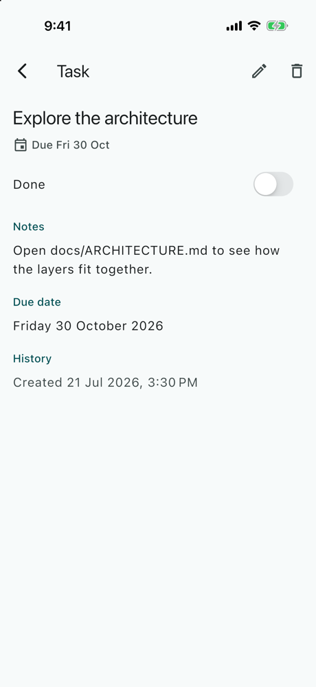
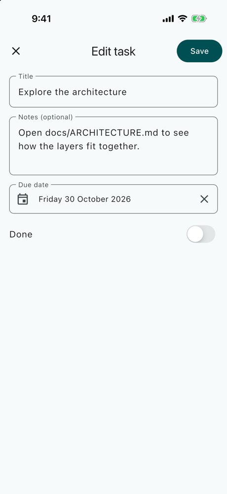
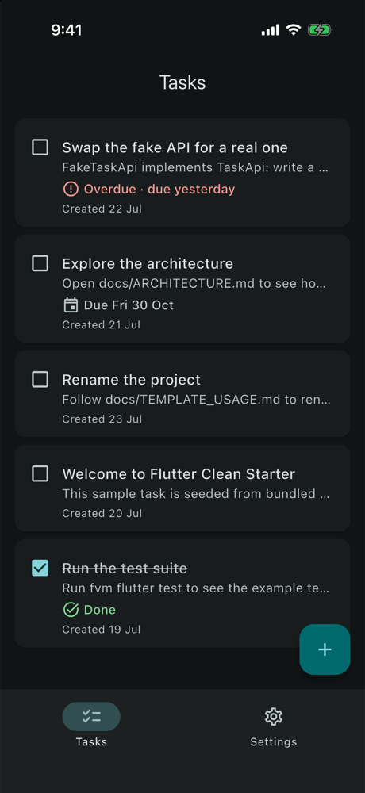
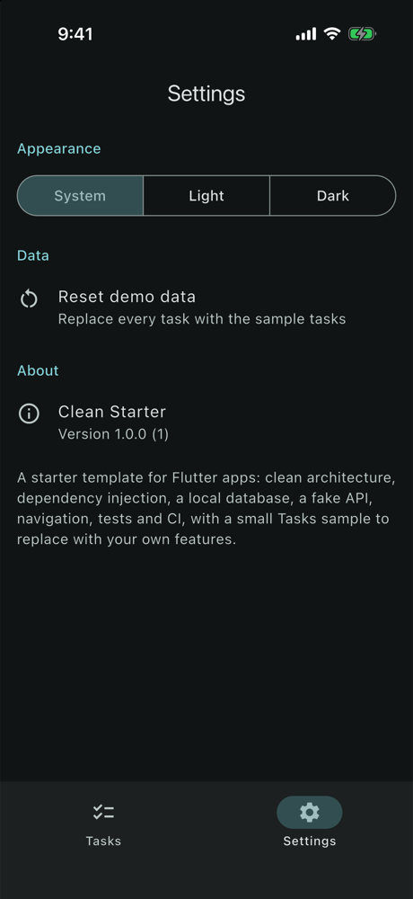
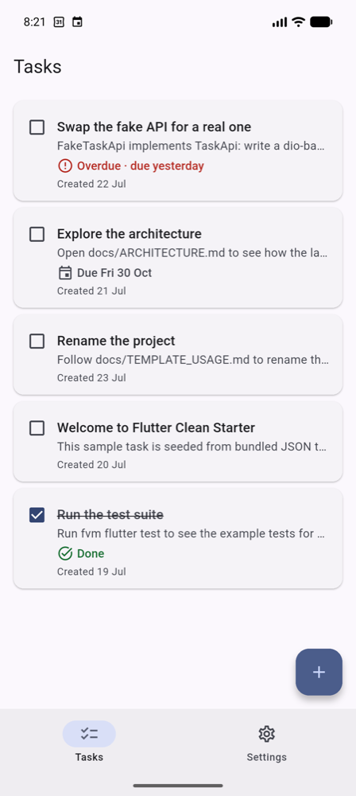

# 🧱 Flutter Clean Starter

[](https://github.com/MuhammadFaheemAkram/FlutterCleanStarter/actions/workflows/flutter-ci.yml)


A **starter template** for Flutter apps. Architecture, DI, persistence, a fake API, navigation, a design system, tests and CI come already wired. One small sample feature, **Tasks**, runs through every layer.

It runs on **Android and iOS**, fully offline: there is **no API key and no server**.

> **Why this repo exists**
>
> Every new app needs the same plumbing before its first feature. This template packages the stack and the lessons of six earlier BitFuse Flutter apps (MovieExplorer to Evently) into something you can:
> 1. **clone** and run straight away (generated code is committed);
> 2. **rename** with one script: package, app IDs, display name (`tool/rename.dart`);
> 3. **strip** of the sample: everything of it has `task` in its name, and the guide lists the few shared edits;
> 4. **extend** by following the Tasks feature's shape, layer by layer.
>
> Both 2 and 3 are **checked**, not just described: a renamed copy analyzes, passes its tests and builds on Android and iOS; a copy with the sample removed analyzes and passes its tests.
>
> It is the Flutter edition of a template that also exists natively for [Android](https://github.com/MuhammadFaheemAkram/AndroidCleanStarter) and [iOS](https://github.com/MuhammadFaheemAkram/SwiftStarterKit). Each build phase has a beginner-to-intermediate friendly write-up in [`docs/`](docs/), which also shows how the Android and iOS editions approached the same step.

---

## 📸 Screenshots

| Tasks | A task | The form |
|:---:|:---:|:---:|
|  |  |  |

| Dark | Settings | Android dynamic color |
|:---:|:---:|:---:|
|  |  |  |

More, with large text and the dialogs: [docs/SCREENSHOTS.md](docs/SCREENSHOTS.md).

---

## ✨ What's Inside

**The template:**
- 🏛️ **Clean architecture:** View → Cubit → use case → repository → drift or the API; `domain/` in pure Dart.
- 💾 **Offline-first persistence:** drift as the single source of truth, with `CHECK`s, transactions and an exported schema; settings in `SharedPreferencesWithCache`, loaded before the first frame.
- 🌐 **A fake API** over bundled JSON, with latency and failures, behind an interface a real `dio` client drops into.
- 🧭 **Typed navigation:** a tab shell, screens above it, full-screen dialogs, links that open cold with a Close button.
- 💉 **DI** with `get_it` + `injectable`: `@module`, `@preResolve`, `@factoryParam`.
- 🎨 **A design system:** themes from one seed, dynamic color on Android 12+, colors that carry meaning, tokens, state views, adaptive dialogs and pickers.
- ♿ **Accessibility:** dark mode and large text everywhere, labels on everything tappable, never color alone, all checked by a test tour.
- ✅ **388 tests** at every layer, mutation-checked; CI on every push.
- 🔧 **`tool/rename.dart`** and **[TEMPLATE_USAGE.md](docs/TEMPLATE_USAGE.md)**.

**The Tasks sample** (to learn from, then delete):
- seeded from the fake API on first launch; mark done, swipe to delete with Undo, pull to refresh (new server tasks are merged in, your edits never overwritten, a deleted task never revived);
- due dates as days, with **Overdue** marked by an icon and the word;
- a detail screen, and one full-screen form for add and edit, with validation and a discard guard;
- Settings: System / Light / Dark, dynamic color, Reset demo data, About.

---

## 🧬 Start a New App From It

```bash
git clone https://github.com/MuhammadFaheemAkram/FlutterCleanStarter.git my_app && cd my_app
fvm install && fvm flutter pub get
fvm dart run tool/rename.dart --package my_app --app-id com.example.myapp --name "My App"
fvm dart fix --apply --code=directives_ordering && fvm dart format .
fvm dart run build_runner build --delete-conflicting-outputs && fvm flutter test
```

Then [remove the Tasks sample](docs/TEMPLATE_USAGE.md#remove-the-tasks-sample) (or keep it while you learn the shape), and [add your first feature](docs/TEMPLATE_USAGE.md#4-add-a-feature) layer by layer. The guide also covers replacing the fake API, what the template deliberately leaves out (onboarding, auth, notifications, background work, flavors, localization), and a pre-release checklist.

---

## 🧰 Tech Stack

The list stays short: every package is one a new app is likely to keep.

| Area | Choice |
|------|--------|
| Toolchain | Flutter 3.47.6 · Dart 3.13, pinned per project with [FVM](https://fvm.app) (`.fvmrc`) |
| Platforms | Android · iOS |
| UI | [`material_ui`](https://pub.dev/packages/material_ui) (Material 3 as a standalone package); [`cupertino_ui`](https://pub.dev/packages/cupertino_ui) for the iOS touches (alerts, the date wheel, switches) |
| State | `flutter_bloc`: a Cubit per screen, and one app-wide `SettingsCubit` |
| Navigation | `go_router` + `go_router_builder` (typed routes, `StatefulShellRoute`) |
| Dependency injection | `get_it` + `injectable` (a code-generated composition root) |
| Models | `freezed` + `json_serializable` (checked DTOs) |
| Database | `drift` + `drift_flutter` (SQLite, typed queries, streams) |
| Preferences | `shared_preferences` (`SharedPreferencesWithCache`) |
| Time and text | `clock` (an injectable "now"), `intl` (dates), `characters` (grapheme-counted limits) |
| Platform | `dynamic_color` (the wallpaper's palette, Android 12+), `package_info_plus` (About) |
| Lints / CI | `flutter_lints` + strict analyzer modes; GitHub Actions |
| Testing | `flutter_test`, `bloc_test`, `mocktail`, `fake_async`; in-memory drift and preferences |

---

## 🏛️ Architecture

```
                 ┌──────────── reads: drift streams ────────────┐
                 ▼                                              │
View ◀── Cubit ◀── UseCase ◀── TaskRepository ── TasksDao ── drift (SQLite)
                                   │                    ▲
                                   │ seed · refresh ·   │ one transaction each
                                   ▼ reset              │
                                TaskApi (FakeTaskApi) ──┘  TaskDto → Task → TaskRow
```

- **drift is the source of truth.** Screens watch its streams; the API only seeds, refreshes and resets.
- **The device owns its data.** A refresh adds the server's new tasks and never overwrites a stored one (`ON CONFLICT DO NOTHING`); a tombstone keeps a deleted task deleted.
- **Three models per record** (DTO, domain, row), with mappers that check the server's data before anything is written.
- **Writes return a `Result`** and never throw; validation is one set of pure rules, shared by the form and the use cases.
- **A Cubit per screen;** one-time effects carry a serial, so each fires once; navigation stays in the View.
- **Settings are app-wide,** above `MaterialApp.router`, and right from the first frame.

The full picture (layers and import rules, who owns what, state, errors, navigation, DI, persistence, time, the sample's boundary, key decisions): [docs/ARCHITECTURE.md](docs/ARCHITECTURE.md).

---

## 🗂️ Folder Structure

```
FlutterCleanStarter/
├── .fvmrc · analysis_options.yaml · build.yaml · .github/
├── lib/
│   ├── main.dart                   # binding → configureDependencies() → runApp
│   ├── app/                        # StarterApp: the app-wide settings, themes and the router
│   ├── core/
│   │   ├── common/                 # Result, AppException, guardWrite, IdGenerator
│   │   ├── design_system/          # theme/, widgets/, date_labels, large_text
│   │   ├── navigation/             # app_routes (+ .g.dart), app_router, the Close fallback
│   │   ├── network/                # AssetJsonLoader, NetworkSimulator, [task_api, fake_task_api, dto/task_dto]
│   │   ├── database/               # AppDatabase, [tables/tasks, daos/tasks_dao]
│   │   ├── storage/                # SettingsLocalDataSource, [tasks_preferences]
│   │   └── platform/               # MaterialYouColorSource
│   ├── data/                       # [mapper/task_mappers], repository/ (settings, [task])
│   ├── domain/                     # model/, [calculation/task_rules], repository/, service/, usecase/
│   ├── features/                   # shell, settings, [tasks, task_detail, task_form]
│   └── di/                         # injection.dart (+ .config.dart), app_module.dart
├── assets/json/                    # [seed_tasks.json]
├── drift_schemas/                  # every exported schema version
├── tool/rename.dart
└── test/                           # mirrors lib/, plus app/ (flows, the tour), tool/ and helpers/
```

`[…]` marks the sample: everything with `task` in its name.

---

## ▶️ How to Run

Prerequisites: [FVM](https://fvm.app); Xcode for iOS; the Android SDK with Java 17+ (Android Studio's bundled JDK works).

```bash
fvm install            # the version pinned in .fvmrc (3.47.6)
fvm flutter pub get
fvm flutter run        # pick an Android emulator or an iOS simulator
```

Generated code (`*.g.dart`, `*.freezed.dart`, `*.config.dart`) is committed. After changing annotated code, regenerate it with `fvm dart run build_runner build --delete-conflicting-outputs`. To see the offline handling, set `NetworkSimulator.shouldThrowError` to `true`.

---

## ✅ Testing

```bash
fvm flutter analyze
fvm dart format --output=none --set-exit-if-changed .
fvm flutter test
```

**388 tests**, all on the host:
- Cubits on a real in-memory data stack;
- views with mocked Cubits;
- the database's own rules, the fake API and the mappers;
- app flows on the real DI graph;
- the rename script on a copy of the real files;
- an accessibility tour of every screen and state, in light and dark at 200 % text.

In every phase, rules were broken on purpose to prove a test notices: **107 mutation checks**, each caught. Details and the gotchas: [docs/TESTING.md](docs/TESTING.md).

CI (`.github/workflows/flutter-ci.yml`) runs on every push to `main` and every pull request. It installs the FVM-pinned Flutter, checks that the committed generated code is current and complete, then runs format, analyze and test.

---

## 📱 Same Template on Other Platforms

| Edition | Stack | Repo |
|---------|-------|------|
| Android | Kotlin · Jetpack Compose · Hilt · Room · DataStore | [MuhammadFaheemAkram/AndroidCleanStarter](https://github.com/MuhammadFaheemAkram/AndroidCleanStarter) |
| iOS | Swift 6 · SwiftUI · SwiftData · `@AppStorage` | [MuhammadFaheemAkram/SwiftStarterKit](https://github.com/MuhammadFaheemAkram/SwiftStarterKit) |
| **Flutter** | Dart · Flutter · Bloc · drift | this repo |

| Concept | Android | iOS | Flutter |
|---|---|---|---|
| UI | Jetpack Compose | SwiftUI | widgets + `material_ui` (adaptive where it matters) |
| Screen state | ViewModel + StateFlow | `@Observable` | Cubit |
| One-time effects | sealed `Effect` + Channel | a dismiss signal | `BlocListener` on a serial or status |
| Navigation | Navigation Compose, bottom nav | `TabView` + `NavigationStack` + `Route` | `StatefulShellRoute` + typed routes |
| Persistence | Room + DataStore | SwiftData + `@AppStorage` | drift + `SharedPreferencesWithCache` |
| Fake API | Retrofit-style service | protocol + bundled JSON | `TaskApi` + `FakeTaskApi` reading bundled JSON |
| DI | Hilt modules | `AppEnvironment` | `get_it` + `injectable` |
| Tests | JUnit, Turbine, Compose UI tests | Swift Testing | `flutter_test`, `bloc_test`, `mocktail`, widget tests |
| CI | `android-ci.yml` | `ios-ci.yml` | `flutter-ci.yml` (generated code checked, format, analyze, test) |
| Template usage | TEMPLATE_USAGE.md | TEMPLATE_USAGE.md | TEMPLATE_USAGE.md + `tool/rename.dart`, both checked on copies |

---

## 📚 Documentation

- [TEMPLATE_USAGE](docs/TEMPLATE_USAGE.md): rename, remove the sample, add a feature, replace the fake API, ship
- [ARCHITECTURE](docs/ARCHITECTURE.md): layers, data, state, errors, navigation, DI, persistence, time
- [TESTING](docs/TESTING.md): what's covered, how the tests are built, the mutation checks
- [LEARNING_NOTES](docs/LEARNING_NOTES.md) and [INTERVIEW_NOTES](docs/INTERVIEW_NOTES.md)
- [ROADMAP](docs/ROADMAP.md) and [SCREENSHOTS](docs/SCREENSHOTS.md)
- The build, phase by phase: [1 Foundation](docs/PHASE_1_SUMMARY.md) · [2 Core data layer](docs/PHASE_2_SUMMARY.md) · [3 The Tasks list](docs/PHASE_3_SUMMARY.md) · [4 Create / Edit + Detail](docs/PHASE_4_SUMMARY.md) · [5 Settings](docs/PHASE_5_SUMMARY.md) · [6 Documentation & CI](docs/PHASE_6_SUMMARY.md)
- [CONTRIBUTING](CONTRIBUTING.md) · [CODE_OF_CONDUCT](CODE_OF_CONDUCT.md) · [SECURITY](SECURITY.md) · [CHANGELOG](CHANGELOG.md)

---

## 📄 License

[MIT](LICENSE) © 2026 BitFuse
