# Screenshots

Captured on Wednesday 28 October 2026 on an **iPhone 17 Pro simulator** (iOS, debug build, status bar fixed at 9:41) and an **Android 16 emulator** (Pixel 10 Pro, a **release** build, for dynamic color), then downscaled to 1000 px tall. Everything on screen is the demo, seeded on a fresh install; its due dates are counted from that day.

## Light

| Tasks | A task | Edit task |
|:---:|:---:|:---:|
| 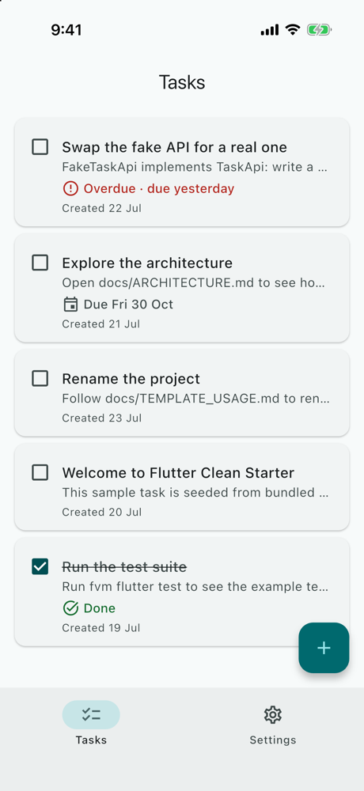 | 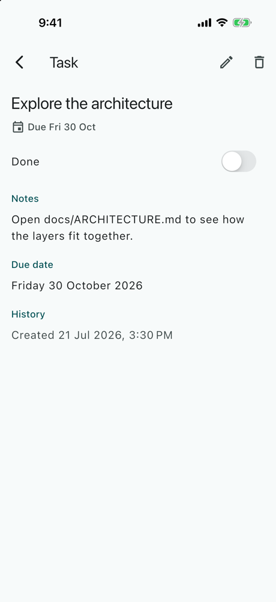 | 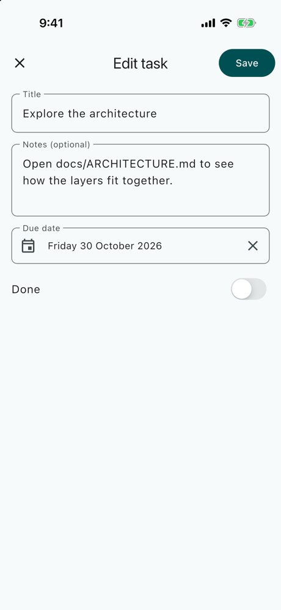 |

| The iOS date wheel | Task deleted, with Undo |
|:---:|:---:|
| 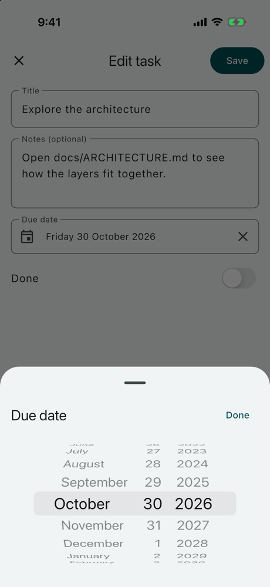 | 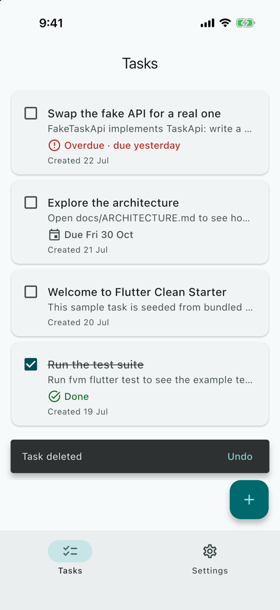 |

## Dark

| Tasks | Delete, asked first | Settings |
|:---:|:---:|:---:|
| 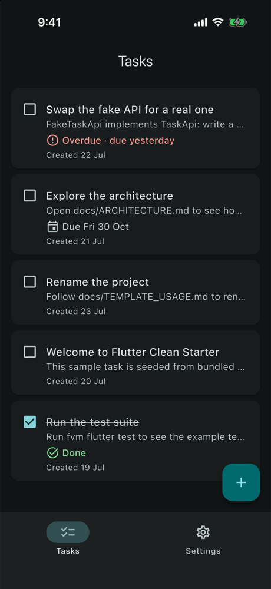 | 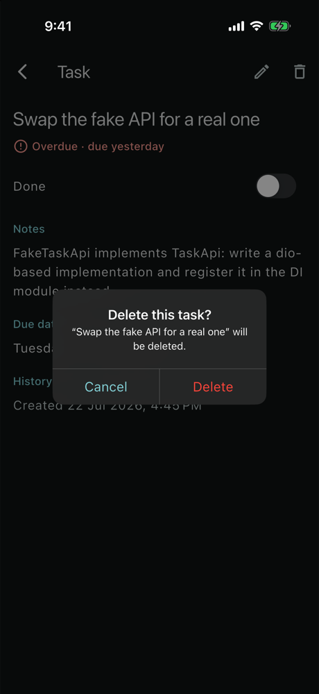 | 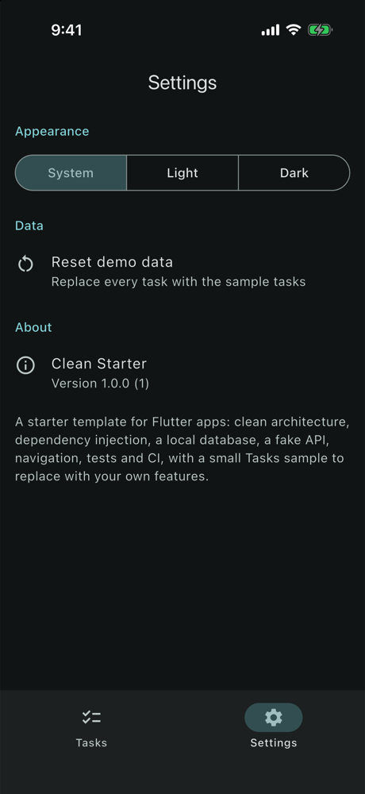 |

## Large text (iOS's largest accessibility size)

| Tasks | Settings |
|:---:|:---:|
| 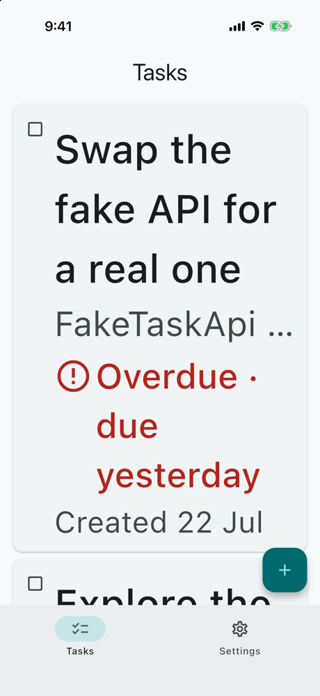 | 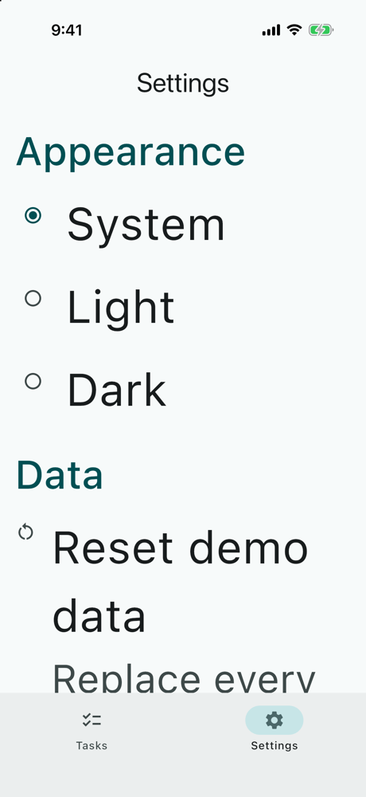 |

## Android dynamic color

| Tasks in the wallpaper's colors | Settings, with the switch |
|:---:|:---:|
| 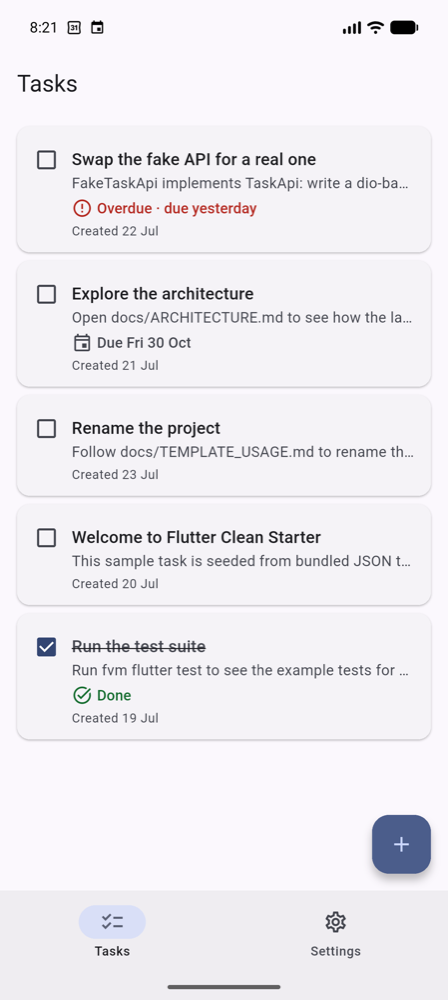 | 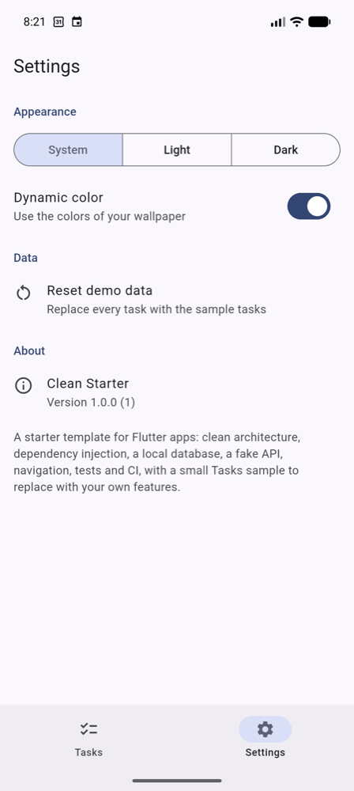 |

## What to look for

- **Never color alone:** "Overdue" has an icon and the word; "Done" has a tick, a struck-through title and the word. The overdue red and done green keep WCAG AA contrast in both themes and on wallpaper palettes (tested).
- **Adaptive where it matters:** an iOS alert with a red destructive action, an iOS switch, and a date wheel in a sheet on iOS; Material's calendar on Android.
- **The Undo SnackBar sits above the Add button,** not over it (the Tasks screen has its own `ScaffoldMessenger`).
- **At the largest text,** segments become a radio list, row icons stay level with their titles, and the status icon grows with its text.
- **Dynamic color** is offered only where the device has wallpaper colors: Android 12+, not iOS.

## Retaking them

1. A fresh install on the iPhone 17 Pro simulator: `xcrun simctl uninstall booted co.bitfuse.flutter.cleanstarter`, then `fvm flutter run`.
2. Fix the status bar: `xcrun simctl status_bar booted override --time 9:41 --batteryState charged --batteryLevel 100`.
3. Dark mode and text size: `xcrun simctl ui booted appearance dark`, `xcrun simctl ui booted content_size accessibility-extra-extra-extra-large`.
4. Capture with `xcrun simctl io booted screenshot <file>.png`, and downscale with `sips -Z 1000`.
5. Afterwards: `xcrun simctl status_bar booted clear`, `appearance light`, `content_size large`.
6. For dynamic color, an Android 12+ emulator with a colorful wallpaper; `adb exec-out screencap -p > <file>.png`.
